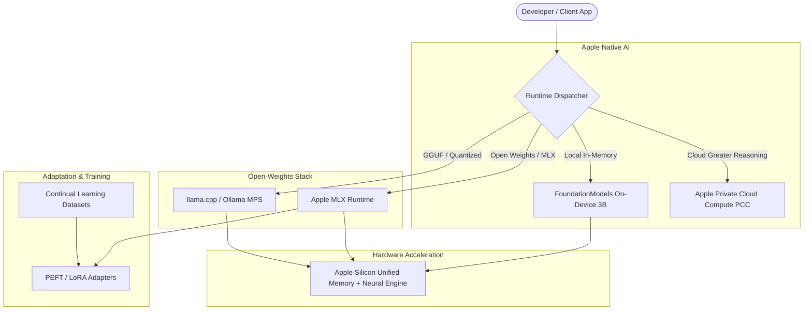

# Mac Local AI Suite: Architecture, Apple Intelligence & Continual Adaptation

A production-ready framework for running, adapting, and orchestrating localized AI workloads directly on Apple Silicon (M-series unified memory) and interfacing with Apple's native **Foundation Models** framework and **Private Cloud Compute (PCC)**.

---

## 📑 Table of Contents
- [Executive Overview](#executive-overview)
- [System Architecture](#system-architecture)
- [macOS Apple Silicon Optimizations & Memory Tuning](#macos-apple-silicon-optimizations--memory-tuning)
- [Prerequisites & Environment Setup](#prerequisites--environment-setup)
- [Apple Developer Account Setup Guide](#apple-developer-account-setup-guide)
- [App Store Small Business Program & Private Cloud Compute (PCC)](#app-store-small-business-program--private-cloud-compute-pcc)
- [Native Foundation Models Client (`AppleIntelligenceClient.app`)](#native-foundation-models-client-appleintelligenceclientapp)
- [Open-Weights Local Inference Engines (MLX & llama.cpp)](#open-weights-local-inference-engines-mlx--llamacpp)
- [Model Adaptation & Fine-Tuning (LoRA / QLoRA)](#model-adaptation--fine-tuning-lora--qlora)
- [Continual Learning & Feedback Loops](#continual-learning--feedback-loops)
- [Automated Scripts](#automated-scripts)

---

## ⚡ Executive Overview

Running enterprise-grade AI locally on macOS requires leveraging **Metal Performance Shaders (MPS)** and **Apple Silicon's Unified Memory Architecture (UMA)**. This repository provides:
- **Zero-Latency Local Inference:** Running quantized open-weights models (4-bit / 8-bit GGUF, MLX, EXL2).
- **Apple FoundationModels Integration:** Native Swift client consuming on-device system models with auto-fallback and capability detection.
- **Private Cloud Compute (PCC) Bridging:** Complete workflow for provisioning, entitling, and routing greater-reasoning queries to Apple's private cloud server clusters.
- **Domain Adaptation:** Parameter-Efficient Fine-Tuning (PEFT/LoRA) optimized for Apple Silicon via Apple MLX and PyTorch MPS.
- **Sanitized & Modular:** Built without hardcoded credentials, using dynamic code-signing detection and configurable placeholders.

---

## 🏛 System Architecture



---

## ⚡ macOS Apple Silicon Optimizations & Memory Tuning

Running large quantization models (such as 32B/70B models or extended context windows) on unified memory requires bypassing macOS's default conservative GPU memory caps and tuning Metal allocation parameters.

### Key Performance Knobs:

1. **Expanding GPU Wired Memory Limits (`iogpu.wired_mem_limit`):**
   - By default, macOS reserves significant memory headroom for system applications, often capping the GPU to ~65–70% of total unified RAM.
   - Adjusting this ceiling allows large models to fit completely into GPU VRAM without premature swapping to SSD.
   - Run the included tuning script:
     ```bash
     chmod +x scripts/optimize_mac_ai.sh
     ./scripts/optimize_mac_ai.sh
     ```

2. **PyTorch MPS High-Watermark Ratio:**
   - Configure PyTorch to safely use up to 85% of available unified memory before triggering garbage collection:
     ```bash
     export PYTORCH_MPS_HIGH_WATERMARK_RATIO=0.85
     export PYTORCH_ENABLE_MPS_FALLBACK=1
     ```

3. **Centralized Model Cache Management:**
   - Avoid duplicate multi-gigabyte model weights across different tools (Ollama, HuggingFace, MLX) by centralizing model caches:
     ```bash
     export OLLAMA_MODELS="$HOME/Models/ollama"
     export HF_HOME="$HOME/Models/huggingface"
     ```

4. **Zero-Telemetry Offline Guards:**
   - Eliminate network latency checks and outbound telemetry stalls when operating in air-gapped or localized environments:
     ```bash
     export DISABLE_TELEMETRY=1
     export HF_HUB_ENABLE_HF_TRANSFER=1
     ```

---

## 🛠 Prerequisites & Environment Setup

### 1. Hardware Requirements
- **Minimum:** Apple Silicon M1/M2/M3/M4 with 16GB Unified Memory.
- **Recommended:** M-series Pro/Max/Ultra with 32GB+ Unified Memory for simultaneous quantized 70B/32B models or concurrent LoRA training.

### 2. Environment Initialization
Run the bootstrap setup to prepare Python, virtual environments, and Apple Silicon drivers:

```bash
# Clone the repository
git clone https://github.com/<YOUR_GITHUB_USERNAME>/mac-local-ai-suite.git
cd mac-local-ai-suite

# Execute system setup
chmod +x scripts/*.sh
./scripts/setup_mac_env.sh
```

---

## 🍎 Apple Developer Account Setup Guide

To compile, codesign, and execute native applications that link against Apple's `FoundationModels.framework` or request higher-privilege entitlements, you need an active Apple Developer profile.

### Step-by-Step Enrollment:
1. **Apple ID:** Ensure you have an Apple ID with Two-Factor Authentication (2FA) enabled.
2. **Apple Developer App:**
   - Download the **Apple Developer** app from the Mac App Store.
   - Navigate to the **Account** tab and select **Enroll in the Apple Developer Program**.
3. **Identity Verification:**
   - Submit your personal or organization details (e.g., photo ID or D-U-N-S number for businesses).
   - Complete the annual membership enrollment ($99 USD/year).
4. **Local Certificate Generation:**
   - Open **Xcode** > **Settings (⌘,)** > **Accounts**.
   - Add your Apple ID and select your Team.
   - Under **Manage Certificates...**, click **+** and choose **Apple Development**.
   - Verify local installation in terminal:
     ```bash
     security find-identity -v -p codesigning
     ```
     *(You should see an identity like: `Apple Development: <YOUR_NAME> (<KEY_ID>)`)*.

---

## ☁️ App Store Small Business Program & Private Cloud Compute (PCC)

Apple gates access to server-side **Private Cloud Compute (PCC)**—the cluster responsible for "Greater Reasoning" in Apple Intelligence—behind specific managed entitlements to prevent server resource abuse.

### 1. Enroll in the Small Business Program
Apple ties developer quotas for server-side compute to the Small Business Program:
1. Navigate to **[developer.apple.com/account](https://developer.apple.com/account)**.
2. Select **Enroll in App Store Small Business Program**.
3. **Associated Accounts Section:**
   - If you do **not** own other developer entities/subsidiaries, select **No** (or leave the associated accounts table empty). Do not type `0`; type `None` if an explicit text entry is demanded.
4. Submit the form (approvals typically process within 24–48 hours).

### 2. Request the PCC Managed Entitlement
1. Once enrolled, visit the official request portal:  
   👉 **[Apple Private Cloud Compute Entitlement Request](https://developer.apple.com/contact/request/private-cloud-compute/)**
2. Submit your Application ID (e.g., `com.<YOUR_ORG>.AppleIntelligenceClient`).
3. Once approved, the entitlement `com.apple.developer.private-cloud-compute` will be assigned to your account profile.

### 3. Registering the App Identifier
1. Go to **Certificates, Identifiers & Profiles** > **Identifiers**.
2. Click **+** > **App IDs** > **App**.
3. Configure:
   - **Description:** `Apple Intelligence Client`
   - **Bundle ID:** `com.<YOUR_ORG>.AppleIntelligenceClient` (must match `CFBundleIdentifier` in `Info.plist`).
4. Under **Capabilities**, verify standard capabilities and save. Once Apple grants PCC, the capability will be active for this App ID.

---

## 🖥 Native Foundation Models Client (`AppleIntelligenceClient.app`)

Located under [`apps/AppleIntelligenceClient/`](file:///apps/AppleIntelligenceClient/):

### Structure:
```text
apps/AppleIntelligenceClient/
├── AppleIntelligenceClient.app/   # Bundle skeleton with Info.plist
├── app.entitlements              # Sandbox & Network Client declarations
├── main.swift                    # Swift entry point calling FoundationModels
└── build_and_sign.sh             # Automated compilation & dynamic codesigning
```

### Features:
- **Resilient Fallback:** Gracefully detects whether cloud compute is permitted; runs locally on `SystemLanguageModel.default` if cloud entitlements are not yet granted.
- **Telemetry Reporting:** Logs total output tokens and intermediate `reasoningTokenCount`.
- **Dynamic Identity Detection:** Automatically detects whichever development certificate is present on your Mac, or falls back to ad-hoc signing (`-`).

### Building & Running:
```bash
cd apps/AppleIntelligenceClient
./build_and_sign.sh
./AppleIntelligenceClient.app/Contents/MacOS/AppleIntelligenceClient
```

---

## 🧠 Open-Weights Local Inference Engines (MLX & llama.cpp)

| Engine | Best For | Supported Formats | Metal Hardware Acceleration |
| :--- | :--- | :--- | :--- |
| **Apple MLX** | Native Apple Silicon optimization, fine-tuning | 4-bit, 8-bit, fp16 | Native Metal C++ kernels |
| **llama.cpp / Ollama** | General purpose, API compatibility, low memory | GGUF (Q4_K_M, Q8_0) | Metal Performance Shaders |

---

## 🎯 Model Adaptation & Fine-Tuning (LoRA / QLoRA)

Adapters allow fine-tuning open-weights base models on specialized domains (e.g., local codebase structures, vision tasks, enterprise tooling) without retraining base weights.

### Directory Layout
```text
adapters/
├── configs/            # Training hyperparameters & configs
├── datasets/           # Formatted JSONL datasets (instruction/response)
└── weights/            # Exported LoRA adapter checkpoints (.safetensors)
```

### Running an MLX LoRA Training Job:
```bash
python3 scripts/train_adapter.py \
  --model mlx-community/Llama-3.2-3B-Instruct-4bit \
  --data adapters/datasets/train.jsonl \
  --output adapters/weights/custom-adapter \
  --iters 600
```

---

## 🔄 Continual Learning & Feedback Loops

1. **Telemetry Capture:** Logging prompts, agent decisions, tool invocations, and user corrections into structured formats.
2. **Data Curation & Deduplication:** Cleans raw transcripts into high-quality instruction-tuning pairs (`train.jsonl`).
3. **Adapter Checkpointing:** Periodic retraining of targeted adapters on weekly/monthly cadence.
4. **Safety & Regression Gate:** Automated validation against benchmark suites before swapping the active adapter.

---

## 🚀 Automated Scripts

- [`scripts/setup_mac_env.sh`](file:///scripts/setup_mac_env.sh): Installs Homebrew packages, Python dependencies, and MLX.
- [`scripts/train_adapter.py`](file:///scripts/train_adapter.py): MLX-based fine-tuning runner for local training on Apple Silicon.
- [`apps/AppleIntelligenceClient/build_and_sign.sh`](file:///apps/AppleIntelligenceClient/build_and_sign.sh): Automated compiler and codesigning harness for the native Apple Intelligence App Bundle.
